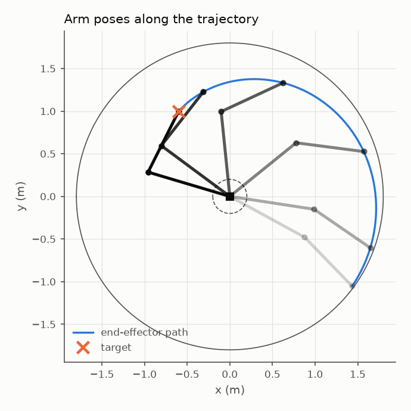
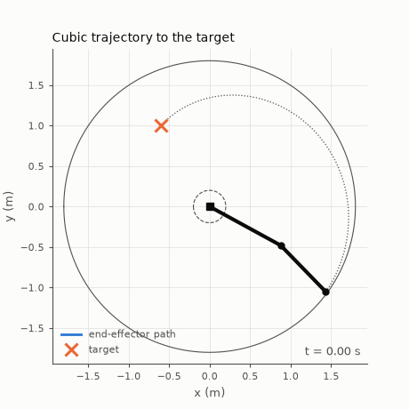
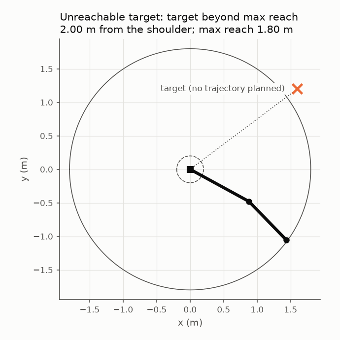

# Manipulator Lab

A planar 2-link robot arm built from the numerical methods up: forward and inverse kinematics, Jacobian conditioning, Newton-based IK, joint-space trajectories, and an animated demo. It is built on [Numerical Method Toolkit](https://github.com/faridakhmad437-bit/Numerical-Method-Toolkit) (NMT, pinned to `v1.0.0`) and was designed so that every claim here comes from a recorded run, not from a guess.

Design and decisions: [SPEC.md](SPEC.md). Why numerical IK degrades near singularities, with the numbers: [docs/ENGINEERING_NOTE.md](docs/ENGINEERING_NOTE.md).

## What was verified

Everything below was run on the author's machine (Windows 11, Python 3.14.3, NumPy 2.5.4, Intel i5-13450HX); the files are in `docs/results/`.

- 279 tests pass and `ruff` is clean. Test groups: kinematics, reachability, Jacobian and workspace, numerical IK, trajectories, visualisation. The test suite was also checked by mutation testing (deliberately broken code must fail a test); the few mutants that survived are listed in SPEC section 13.
- Analytic IK round-trips through FK within the tested tolerance of `1e-9 m`. Newton IK agrees with it to `8.9e-16 rad` away from the boundaries.
- The closed-form Jacobian condition number agrees with the SVD to `4.7e-14` (relative) on 102,564 workspace cells, and diverges like `1/sqrt(g)` at distance `g` from either boundary.
- Cubic trajectories meet their boundary conditions to `4.4e-16 rad`; the closed-form coefficients match an independent 4x4 solve with NMT's `gaussian_elimination` to `4.6e-16` (relative).
- The demo animation's last frame lies within `1e-9 m` of the target and every frame keeps the link lengths; an unreachable target is rejected with its reason and no trajectory is invented.

No performance claims are made. Runtime was measured once (`docs/results/ik_comparison_summary.json`), varies by about 30% between runs on the same machine, and is not summarised as a speed ratio.

## Findings and limitations

- **Near the folded boundary, `default_initial_guess` does not reliably select the requested IK branch** (within about 0.3 m of the inner boundary). A Newton iterate lands close to the singular pose, the next step is enormous (112.9 rad in the traced case), and the final branch depends on where it lands. Pass `initial=` explicitly there. The pre-registered criteria for this check failed once; the revised criteria were written after seeing the failure (post hoc), and both are kept. Details: [ENGINEERING_NOTE](docs/ENGINEERING_NOTE.md).
- **At the stretched boundary** Newton still converges, but slower; at the singular point itself convergence is linear (28 iterations versus 6 in the interior).
- **Trajectories are interpolated in joint space** with `qf - q0` taken literally (no shortest-way angle wrapping). In a random sample 25.3% of trajectories rotated a joint by more than pi, and the end-effector path is generally not straight. Planning in task space is not implemented.
- `viz` draws what the planner produced; it does not draw a "closest reachable pose" for unreachable targets.
- One arm geometry (`l1 = 1.0`, `l2 = 0.8`) and one machine. Not tested: other link ratios, other platforms or Python versions, damped or globalised Newton variants.

## Conventions

- Units: metres, radians, seconds. World frame at the shoulder, x right, y up, CCW positive.
- `theta1` is absolute; `theta2` is relative to link 1.
- **Elbow-up = negative `theta2`**, elbow-down = positive `theta2`.
- Defaults: `l1 = 1.0 m`, `l2 = 0.8 m` (reach `0.2 <= r <= 1.8 m`).
- Unreachable targets return `reachable=False` with a `reason`; invalid inputs raise `ValueError`.
- A pose is singular when `|sin(theta2)| < 1e-6`; `condition_number` returns `inf` when the Jacobian is numerically rank-deficient.

## Quick start (Windows PowerShell)

```powershell
python -m venv .venv
.\.venv\Scripts\Activate.ps1
pip install -e ".[dev]"
pytest
ruff check .
```

```python
from manipulator_lab import PlanarArm, Branch, fk, ik_analytic, ik_newton, jacobian, condition_number

arm = PlanarArm()
result = ik_analytic(arm, (1.0, 0.5), Branch.ELBOW_UP)
print(result.reachable, result.theta, fk(arm, result.theta))
print(condition_number(arm, result.theta))

# Numerical IK: the initial guess decides the branch
num = ik_newton(arm, (1.0, 0.5), initial=(0.3, -0.5))
print(num.converged, num.theta, num.iterations, num.branch)

# Joint-space trajectory to a task-space target (elbow-up by default)
from manipulator_lab import trajectory

t = trajectory.time_grid(2.0, 201)
plan = trajectory.plan_to_target(arm, (0.3, -0.4), (1.0, 0.5), 2.0, t, profile="cubic")
if plan.ok:
    print(plan.trajectory.q[-1], plan.trajectory.qd[-1])   # goal angles, zero velocity
else:
    print(plan.reason)                                      # e.g. target_beyond_max_reach

# Drawing and animation (needs matplotlib; not imported by the package itself)
from manipulator_lab import viz

anim = viz.animate_plan(arm, plan, (1.0, 0.5), n_frames=60)
viz.save_gif(anim, "reach.gif", fps=20, hold=20)
```

## Reproducing the results

```powershell
python experiments/run_conditioning.py    # docs/results/conditioning_*.{png,json}
python experiments/run_ik_comparison.py   # docs/results/ik_*.{png,json}
python experiments/run_trajectory.py      # docs/results/trajectory_*.{png,json}
python experiments/run_demo.py            # docs/results/demo_*.{gif,png,json}
python experiments/trace_newton.py        # iterate table behind the engineering note (prints only)
```

Each run writes its parameters and the measurement environment (Python, NumPy, OS, CPU, git commit) next to the results. The success criteria are written in each script's docstring before the script was run, and the script exits with status 1 if a criterion fails. Re-running rewrites the JSON files (the recorded commit and any timings change), so commit regenerated results deliberately.

## Results at a glance

| Experiment | Question | Outcome |
|---|---|---|
| Conditioning | Does `cond(J)` depend on `theta2` only, and match the closed form? | Yes; max relative difference 4.7e-14 over 102,564 cells |
| Newton vs analytic IK | Same answer from the same start? | Yes in the interior (936/936 on the requested branch, 8.9e-16 rad); the pre-registered check with a 0.05 m margin failed (1008/1080 on the requested branch), see findings |
| Trajectories | Boundary conditions, cubic coefficients, profile cost | All seven pre-registered criteria met on 1000 random cases |
| Demo | End-to-end run, frame-by-frame agreement with FK, unreachable case | All four pre-registered criteria met |







## Layout

```
src/manipulator_lab/   arm.py, kinematics.py, workspace.py, ik_numeric.py, trajectory.py, viz.py
tests/                 test_kinematics.py (A), test_reachability.py (B), test_jacobian.py, test_workspace.py,
                       test_ik_numeric.py (D), test_trajectory.py (C), test_viz.py
experiments/           run_conditioning.py, run_ik_comparison.py, run_trajectory.py, run_demo.py,
                       trace_newton.py, env_info.py
docs/                  ENGINEERING_NOTE.md; results/ holds recorded plots, tables and environment metadata
```

## License

MIT. See [LICENSE](LICENSE).
